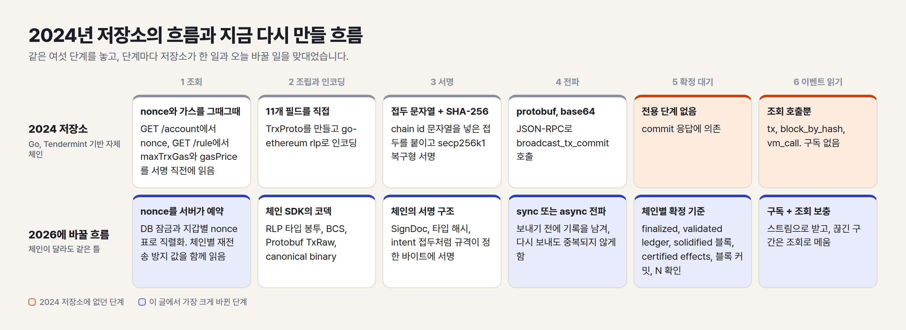
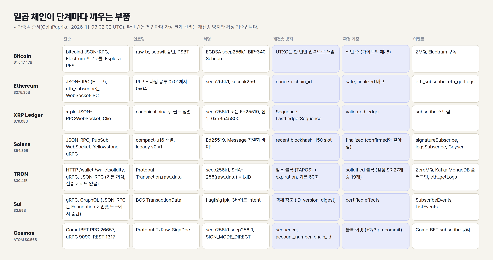
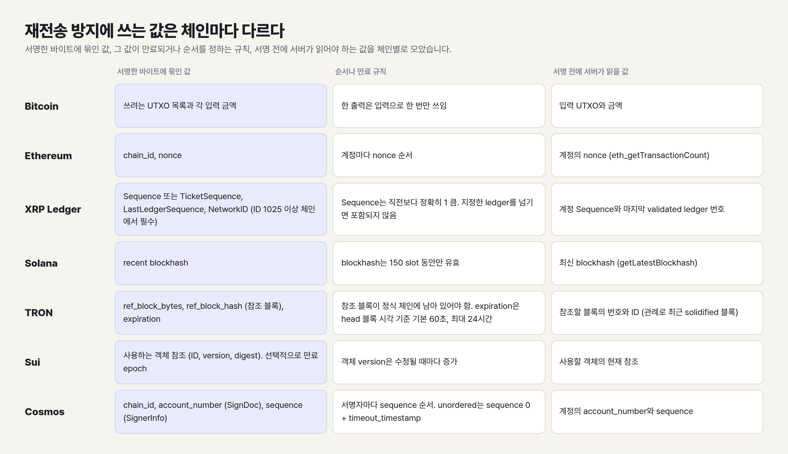
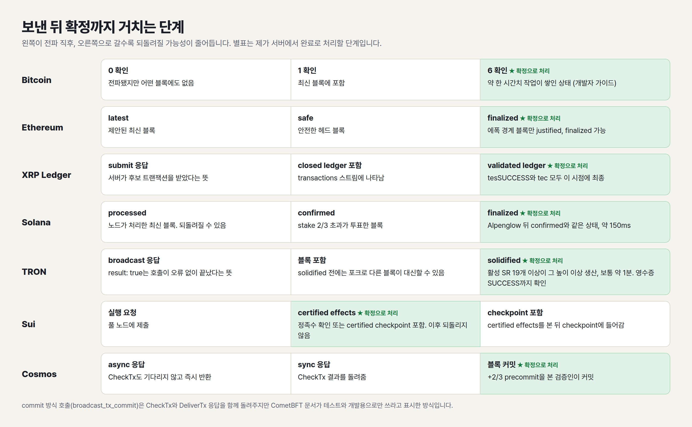

안녕하세요. <strong>Kyle</strong>입니다.

2024년에 [Chain Communicator](/blog/archive/chain-communicator)라는 글을 썼습니다. Tendermint 기반 체인 하나를 대상으로 트랜잭션 조립, 인코딩, 서명, RPC 호출을 라이브러리 없이 직접 구현한 기록이었습니다. 2년 사이에 체인들의 전송 방식과 확정 기준이 여러 번 바뀌어서, 같은 질문을 일곱 체인에 던지는 v2를 썼습니다.

---

## 0. TL;DR

**첫째, 2024년 저장소의 흐름은 일곱 체인에 그대로 적용되지만, 저장소에 없던 두 단계가 운영에서 문제를 가릅니다.** 하나는 전파 응답과 확정을 나누는 일이고, 다른 하나는 이벤트를 구독으로 받고 놓친 구간을 조회로 메우는 일입니다.

**둘째, 재전송 방지에 쓰는 값은 체인마다 다르고, 그 값은 서명 전에 서버가 읽어 두어야 하는 값입니다.** nonce와 chain id, 최근 blockhash, 참조 블록과 만료 시각, 객체 참조, Sequence와 만료 ledger, account_number와 sequence, 이미 쓴 UTXO가 각각 그 값입니다.

**셋째, 2025년과 2026년에 서버 코드가 영향을 받는 변경이 일곱 체인 가운데 여섯 체인에 있었습니다.** Ethereum의 트랜잭션 타입 0x04와 트랜잭션당 가스 상한, Solana의 4,096바이트 트랜잭션과 Alpenglow, TRON 이벤트 플러그인 v3.0.0의 `removed` 필드, Sui의 JSON-RPC 중단, Cosmos SDK의 unordered 트랜잭션과 v0.55, Bitcoin Core 30의 데이터 출력 정책이 그 예입니다.

---

## 1. 2024년 저장소가 구현한 범위는 조회에서 전파까지

[저장소](https://github.com/kyle-park-io/chain-communicator)는 Go로 썼고 2024-05-07에 만들어 2024-08-29에 마지막으로 푸시했습니다. 체인 이름은 코드에 없습니다. 확인되는 것은 `/account`와 `/rule`이라는 자체 조회 엔드포인트, `vm_call`이라는 RPC 메서드, Tendermint 계열의 `broadcast_tx_commit`입니다. 체인 ID는 "testnet"과 "mainnet"이라는 문자열 상수였습니다.

흐름은 이랬습니다. `/account`에서 nonce를, `/rule`에서 `maxTrxGas`와 `gasPrice`를 읽었습니다. [`trx.proto`](https://github.com/kyle-park-io/chain-communicator/blob/main/src/proto/trx.proto)의 `TrxProto` 11개 필드(version, time, nonce, from, to, amount, gas, gasPrice, type, payload, sig)를 채우고 go-ethereum의 `rlp`로 인코딩했습니다. 서명 대상은 `"\x19<NETWORK>(<chainId>) Signed Message:\n<길이>"` 접두에 RLP 바이트를 이은 값이었습니다. 이 값을 SHA-256으로 해시하고 go-ethereum의 `crypto.Sign`으로 서명했으며, 서명을 `sig`에 넣어 protobuf로 직렬화한 뒤 base64로 보냈습니다([`transfer.go`](https://github.com/kyle-park-io/chain-communicator/blob/main/src/internal/transfer.go), [`sign.go`](https://github.com/kyle-park-io/chain-communicator/blob/main/src/utils/sign.go)). 전파는 JSON-RPC `broadcast_tx_commit`이었고, `broadcast_tx_sync`와 `broadcast_tx_async`는 주석으로 남아 있습니다([`tendermint_rpc_post.go`](https://github.com/kyle-park-io/chain-communicator/blob/main/src/rpc/tendermint_rpc_post.go)).

오늘 이 코드를 다시 짠다면 바꿀 것은 여섯 가지입니다. 아래 표는 저장소가 한 일과 바꿀 일을 단계별로 맞댄 것입니다.

| 단계 | 2024 저장소 | 오늘 바꿀 것 |
| --- | --- | --- |
| 전파 | `broadcast_tx_commit` 호출 | sync 또는 async 호출과 별도 확인 |
| 서명 | 접두 문자열과 SHA-256 | 체인 규격이 정한 서명 구조 |
| 인코딩 | RLP와 protobuf 직접 구현 | 체인 SDK의 코덱 |
| nonce | 서명 직전 조회 | 서버에서 예약하고 직렬화 |
| 확정 | 전용 단계 없음 | 체인별 확정 기준 |
| 이벤트 | `tx`, `block_by_hash` 조회 | 구독과 조회 보충 |

전파가 첫 번째 이유입니다. CometBFT의 [OpenAPI 정의](https://github.com/cometbft/cometbft/blob/main/rpc/openapi/openapi.yaml)는 `broadcast_tx_commit`에 "use only for testing and development. In production, use BroadcastTxSync or BroadcastTxAsync"라고 적어 두었습니다. 서명은 두 번째입니다. Cosmos SDK 문서는 Protobuf 직렬화가 결정적이지 않기 때문에 `TxRaw`라는 별도 타입으로 서명할 바이트를 고정한다고 설명합니다([Transactions](https://github.com/cosmos/cosmos-sdk/blob/main/docs/docs/learn/advanced/01-transactions.md)). 2024년 저장소처럼 직접 짠 접두 규칙은 체인이 정한 구조와 맞지 않으면 서명이 검증되지 않습니다.

도식은 2024 저장소에 없던 두 단계(확정 대기, 이벤트 읽기)를 주황색으로 표시했고, 이 글에서 가장 크게 바뀐 단계를 파란색으로 표시했습니다.

---

## 2. 일곱 체인의 공통 파이프라인과 단계별 차이

다루는 체인은 처음 정한 Bitcoin, Ethereum, XRP Ledger, Solana, Sui, Cosmos 여섯 체인에, 재전송을 막는 방식이 이 여섯 체인과 다른 TRON을 더한 일곱 체인입니다. 시가총액 순위로 고른 목록이 아니어서, 아래 스냅샷에서 Sui보다 순위가 높은 BNB Chain(BNB 4위), Hyperliquid(HYPE 10위), Dogecoin(DOGE 12위) 같은 체인은 다루지 않았습니다. 체인 순서는 시가총액 순서입니다. [CoinPaprika `/v1/tickers`](https://api.coinpaprika.com/v1/tickers)의 2026-11-03 02:02 UTC 스냅샷에서 Bitcoin 1,547.47B, Ethereum 275.35B, XRP 79.08B, Solana 54.36B, TRON 30.41B, Sui 3.59B, ATOM 0.56B 달러였습니다. 단일 출처의 단일 시점 값이라 날짜가 바뀌면 순서도 바뀔 수 있습니다.

파이프라인은 조회, 조립과 인코딩, 서명, 전파, 확정 대기, 이벤트 읽기입니다. 아래 표는 체인마다 각 단계에 무엇을 끼우는지 모은 것이고, 이후 절은 이 표의 행을 하나씩 풀어 씁니다.

표의 파란 칸은 체인마다 가장 크게 갈리는 재전송 방지와 확정 기준입니다.

---

## 3. Bitcoin, nonce 없이 입력 UTXO가 순서를 정하는 구조

Bitcoin에는 계정 잔액이 없습니다. 거래는 이전 거래의 출력(UTXO)을 입력으로 지정합니다. [개발자 가이드](https://developer.bitcoin.org/devguide/block_chain.html)는 한 거래의 각 출력이 블록체인에서 입력으로 한 번만 쓰일 수 있고, 이후의 참조는 금지된 이중 지불이라고 적었습니다. nonce나 chain id 같은 별도 값이 없고, 이미 소비된 출력이 재사용을 막는다고 이해합니다.

전송은 노드를 직접 운영하느냐에 따라 갈립니다. `bitcoind`는 JSON-RPC가 기본으로 켜져 있고([JSON-RPC interface](https://github.com/bitcoin/bitcoin/blob/master/doc/JSON-RPC-interface.md)), 직렬화한 16진 거래는 [`sendrawtransaction "hexstring" ( maxfeerate )`](https://developer.bitcoin.org/reference/rpc/sendrawtransaction.html)로 로컬 노드와 네트워크에 제출합니다. 노드를 두지 않으면 [Electrum 프로토콜](https://github.com/spesmilo/electrum-protocol)(JSON-RPC 기반이고 TCP, SSL, WS, WSS 전송을 예로 듭니다)의 `blockchain.transaction.broadcast`나 [Esplora](https://github.com/Blockstream/esplora/blob/master/API.md)의 `POST /tx`(16진 본문을 보내면 txid를 돌려줍니다)를 씁니다.

인코딩은 raw 트랜잭션입니다. [BIP-141](https://github.com/bitcoin/bips/blob/master/bip-0141.mediawiki)이 증인(witness) 구조를 분리했고, 서명하는 장치와 거래를 조립하는 서버가 다르면 [BIP-174](https://github.com/bitcoin/bips/blob/master/bip-0174.mediawiki)의 PSBT로 서명에 필요한 정보를 넘깁니다. 서명은 ECDSA(secp256k1)와 [BIP-340](https://github.com/bitcoin/bips/blob/master/bip-0340.mediawiki)의 Schnorr가 있습니다. [BIP-143](https://github.com/bitcoin/bips/blob/master/bip-0143.mediawiki)은 모든 sighash 유형이 서명하는 입력의 금액에 커밋한다고 적었고, [BIP-341](https://github.com/bitcoin/bips/blob/master/bip-0341.mediawiki)은 서명 메시지가 모든 입력의 금액에 커밋한다고 적었습니다. 서버는 서명 전에 입력 UTXO의 금액을 알고 있어야 합니다.

확정은 확인 수로 셉니다. 개발자 가이드의 [결제 처리](https://developer.bitcoin.org/devguide/payment_processing.html) 절은 0 확인을 "블록에 포함되지 않은 상태, 위험 분석 없이 신뢰하지 말 것"으로, 1 확인을 이중 지불 위험이 크게 줄어드는 상태로, 6 확인을 약 한 시간치 작업이 쌓인 상태로 설명합니다. 저는 서버의 완료 처리를 6 확인에 두겠습니다.

이벤트는 두 갈래입니다. 노드에서는 [ZMQ](https://github.com/bitcoin/bitcoin/blob/master/doc/zmq.md)로 `-zmqpubhashtx`, `-zmqpubhashblock`, `-zmqpubrawblock`, `-zmqpubrawtx`, `-zmqpubsequence` 옵션을 켭니다. Electrum 서버에서는 [protocol-methods](https://github.com/spesmilo/electrum-protocol/blob/master/docs/protocol-methods.rst)의 `blockchain.scriptpubkey.subscribe`로 주소(scriptPubKey)의 상태 변화를 받고, `blockchain.outpoint.subscribe`로 특정 출력이 쓰였는지 추적합니다. 두 메서드는 문서에 프로토콜 1.7에서 추가됐다고 적혀 있습니다.

2025년과 2026년의 변화는 릴레이 정책입니다. [Bitcoin Core 30.0 릴리스 노트](https://github.com/bitcoin/bitcoin/blob/master/doc/release-notes/release-notes-30.0.md)에 따르면 `-datacarriersize` 기본값이 100,000으로 늘어 사실상 제한이 사라졌고(예전 제한으로 되돌리려면 `-datacarriersize=83`), OP_RETURN 출력을 한 거래에 여러 개 넣는 것이 릴레이와 채굴에서 허용됩니다. 지갑은 TRUC 거래를 받고 만드는 기능을 얻었습니다. 정책 변경이라서 노드 버전에 따라 같은 거래가 전파되거나 거부될 수 있다고 판단합니다.

---

## 4. Ethereum, 타입 봉투와 nonce가 정하는 순서

Ethereum의 [JSON-RPC](https://ethereum.org/developers/docs/apis/json-rpc/)는 전송 방식에 의존하지 않는 규격이라 소켓과 HTTP에서 모두 쓸 수 있습니다. 구독인 [`eth_subscribe`](https://github.com/ethereum/execution-apis/blob/main/src/eth/subscribe.yaml)는 서버가 먼저 알림을 보낼 수 있는 전송(WebSocket, IPC)에서만 동작합니다.

인코딩은 RLP이고, [EIP-2718](https://eips.ethereum.org/EIPS/eip-2718)이 `TransactionType || TransactionPayload`라는 타입 봉투를 만들었습니다. 지금 쓰이는 타입은 0x01([EIP-2930](https://eips.ethereum.org/EIPS/eip-2930), 접근 목록), 0x02([EIP-1559](https://eips.ethereum.org/EIPS/eip-1559)), 0x03([EIP-4844](https://eips.ethereum.org/EIPS/eip-4844), 블롭), 0x04([EIP-7702](https://eips.ethereum.org/EIPS/eip-7702), 코드 설정)입니다. 서명은 secp256k1이고, EIP-1559의 서명 대상은 `keccak256(0x02 || rlp([chain_id, nonce, max_priority_fee_per_gas, max_fee_per_gas, gas_limit, destination, amount, data, access_list]))`입니다. 타입 봉투 이전의 legacy 거래는 [EIP-155](https://eips.ethereum.org/EIPS/eip-155)가 `chainid`를 서명 대상 해시에 넣고 `v = {0,1} + CHAIN_ID * 2 + 35`로 계산합니다. 2024년 저장소의 서명은 `v`가 0 또는 1인 복구형이어서 EIP-155를 적용하지 않았고, 대신 chain id 문자열을 접두에 넣어 같은 목적을 맡겼습니다.

재전송 방지는 nonce와 chain_id입니다. 서버에서는 nonce가 문제가 됩니다. pay-lab 프로젝트에서 가상 학생 30명 규모의 부하 시험을 돌렸더니, Vercel 서버리스 함수 여러 개가 같은 nonce로 트랜잭션을 만들어 30건 중 3건에서 8건이 실패했습니다. PostgreSQL advisory lock으로 서버 지갑의 전송을 직렬화하고 지갑별 nonce 표를 두어 고쳤습니다. 체인을 읽는 코드(`eth_getTransactionCount`)는 그대로였고, 문제는 읽은 값을 쓰기 전에 다른 요청이 같은 값을 읽는 틈이었습니다.

전파는 `eth_sendRawTransaction`이고 응답은 트랜잭션 해시입니다. 실행 결과나 포함 여부는 이 응답에 없습니다. 블롭 거래는 [execution-apis의 정의](https://github.com/ethereum/execution-apis/blob/main/src/eth/submit.yaml)가 EIP-4844와 [EIP-7594](https://eips.ethereum.org/EIPS/eip-7594) 거래의 raw 형식으로 블롭, KZG 커밋먼트와 증명을 포함한 network form을 요구한다고 적었고, 예전 증명 형식은 RPC에서 노드가 변환해 받아들일 수 있다고 적었습니다.

확정 기준은 블록 태그입니다. 정의에는 `latest`(제안된 최신 블록), `safe`, `finalized`가 있습니다([JSON-RPC 문서](https://ethereum.org/developers/docs/apis/json-rpc/)). [Gasper 문서](https://ethereum.org/developers/docs/consensus-mechanisms/pos/gasper/)에 따르면 에폭 경계 블록만 justified와 finalized가 될 수 있습니다. 저는 완료 처리를 `finalized`에 둡니다.

이벤트는 `eth_subscribe`의 `newHeads`, `logs`, `newPendingTransactions`, `transactionReceipts` 종류로 받습니다. `logs`는 재구성(reorg)으로 사라진 로그를 `removed: true`로 다시 보냅니다. `transactionReceipts`는 execution-apis `main`의 정의에 있는 종류라서 노드 클라이언트가 지원하는지 확인한 뒤 써야 합니다. 놓친 구간은 `eth_getLogs`로 채웁니다.

2025년과 2026년에는 두 번의 하드포크가 있었습니다. [Pectra](https://ethereum.org/roadmap/pectra/)는 2025-05-07에 적용되어 타입 0x04(EIP-7702)가 들어왔고, [Fusaka](https://ethereum.org/roadmap/fusaka/)는 2025-12-03에 적용되었습니다. Fusaka의 메타 EIP인 [EIP-7607](https://eips.ethereum.org/EIPS/eip-7607)에는 [EIP-7825](https://eips.ethereum.org/EIPS/eip-7825)(Final)가 들어 있고, 이 EIP는 트랜잭션 하나의 가스 사용량 상한을 16,777,216(2^24)으로 정합니다. 가스 한도를 직접 정해서 보내는 서버는 이 값을 넘기지 않는지 확인해야 한다고 봅니다.

---

## 5. XRP Ledger, Sequence와 만료 ledger를 함께 서명하는 방식

[`xrpld`](https://xrpl.org/docs/references/http-websocket-apis/api-conventions)(문서가 서버를 부르는 이름입니다)는 JSON-RPC와 WebSocket을 제공하고, [Clio](https://xrpl.org/docs/concepts/networks-and-servers/the-clio-server)는 validated ledger 데이터를 서빙하는 API 서버입니다. 전파는 `submit` 메서드에 서명한 `tx_blob`을 넘기는 방식입니다([Reliable Transaction Submission](https://xrpl.org/docs/concepts/transactions/reliable-transaction-submission)).

인코딩은 [canonical binary format](https://xrpl.org/docs/references/protocol/binary-format)입니다. 같은 데이터를 JSON은 여러 방식으로 나타낼 수 있어서 서명용 직렬화로 부적합하다고 문서가 설명하고, 필드를 canonical order로 정렬합니다. 해시 앞에 단일 서명이면 `0x53545800`, 다중 서명이면 `0x534D5400` 접두를 붙입니다. 키는 [secp256k1 또는 ed25519](https://xrpl.org/docs/concepts/accounts/cryptographic-keys)입니다.

재전송 방지는 [공통 필드](https://xrpl.org/docs/references/protocol/transactions/common-fields)의 `Sequence`입니다. 같은 계정의 직전 거래보다 정확히 1 커야 유효하고, `Sequence`를 0으로 두고 `TicketSequence`를 쓰면 티켓으로 순서를 우회합니다. `LastLedgerSequence`는 해당 ledger까지만 거래가 포함되도록 상한을 거는 필드입니다. 신뢰성 문서는 모든 거래에 이 값을 지정하라고 권하고, 자동화에서는 마지막 validated ledger 번호에 4를 더한 값을 쓰라고 합니다. `NetworkID`는 메인넷에서는 생략하고 네트워크 ID가 1025 이상인 체인에서 필수입니다.

확정은 validated ledger입니다. [Finality of Results](https://xrpl.org/docs/concepts/transactions/finality-of-results)에 따르면 `tesSUCCESS`와 모든 `tec` 코드가 validated ledger에 포함됐을 때 최종입니다. `submit`이 성공 코드를 돌려줘도 그것은 서버가 후보 거래를 받았다는 뜻이고 적용 여부는 정해지지 않았다고 문서가 적었습니다.

이벤트는 [`subscribe`](https://xrpl.org/docs/references/http-websocket-apis/public-api-methods/subscription-methods/subscribe)의 스트림으로 받습니다. `ledger`는 새 validated ledger가 선언될 때마다, `transactions`는 closed ledger에 거래가 들어갈 때마다 메시지를 보냅니다. 그 밖에 `transactions_proposed`, `validations`, `book_changes`, `consensus`가 있습니다.

---

## 6. Solana, 150 slot 안에 보내야 하는 blockhash와 2026년의 큰 변경 두 가지

Solana의 [RPC](https://github.com/solana-foundation/solana-com/blob/main/apps/docs/content/docs/en/rpc/index.mdx)는 HTTP JSON-RPC와 [PubSub WebSocket](https://github.com/solana-foundation/solana-com/blob/main/apps/docs/content/docs/en/rpc/websocket/index.mdx)으로 나뉩니다. WebSocket에는 `accountSubscribe`, `logsSubscribe`, `signatureSubscribe`가 있습니다. 대량 수신에는 Geyser 기반의 [Yellowstone gRPC](https://github.com/rpcpool/yellowstone-grpc)가 있고, README는 Triton One이 만들고 관리한다고 적었습니다.

인코딩은 [트랜잭션 구조](https://github.com/solana-foundation/solana-com/blob/main/apps/docs/content/docs/en/core/transactions/transaction-structure.mdx)의 compact-u16 길이 접두 배열입니다. 서명은 Ed25519이고 직렬화한 `Message`에 대한 64바이트 서명입니다. 형식은 legacy, v0([Address Lookup Tables](https://github.com/solana-foundation/solana-com/blob/main/apps/docs/content/docs/en/core/transactions/versioned-transactions.mdx)로 계정을 1바이트 인덱스로 참조), v1 세 가지입니다.

재전송 방지는 `recent_blockhash`입니다. 트랜잭션 구조 문서는 blockhash가 150 slot 뒤에 만료된다고 적었습니다. 서버는 [`getLatestBlockhash`](https://github.com/solana-foundation/solana-com/blob/main/apps/docs/content/docs/en/rpc/http/getlatestblockhash.mdx)로 받은 값을 서명에 넣고, 그 안에 `sendTransaction`으로 보내야 합니다. nonce 표를 서버에서 관리할 필요는 없지만 만료 시간이 짧아서 재시도 전략이 필요합니다.

확정 기준은 commitment 레벨입니다. [RPC 문서](https://github.com/solana-foundation/solana-com/blob/main/apps/docs/content/docs/en/rpc/index.mdx)에서 `processed`는 노드가 처리한 가장 최신 블록으로 되돌려질 수 있고, `confirmed`는 전체 stake의 3분의 2를 넘는 투표를 받은 블록입니다.

일곱 체인 가운데 2025년과 2026년에 서버가 대응할 변경이 가장 많았던 체인입니다. 첫째, [더 큰 트랜잭션](https://github.com/solana-foundation/solana-com/blob/main/apps/media/content/upgrades/larger-transaction-sizes.mdx)입니다. 최대 크기가 1,232바이트에서 4,096바이트로 늘었고, `txv1` 기능은 메인넷 에폭 1035가 시작한 2026-09-15 01:00 UTC 무렵에 활성화됐습니다. v1 형식은 보내는 쪽에서는 선택이지만 읽는 쪽에서는 필수라고 문서가 적었고, v1에는 Address Lookup Table가 없어서 계정 64개를 트랜잭션에 직접 넣습니다. 둘째, [Alpenglow](https://github.com/solana-foundation/solana-com/blob/main/apps/media/content/upgrades/alpenglow.mdx)입니다. 에폭 1064가 시작한 2026-10-21 13:36 UTC 무렵에 메인넷에 적용됐고, 최종성이 약 150ms를 목표로 합니다. 문서는 `confirmed`와 `finalized`가 같은 상태를 가리키니 새 코드는 `finalized`를 쓰라고 하고, `confirmed` 읽기는 이후 릴리스에서 제거된다고 적었습니다. 투표가 트랜잭션이 아니라 인증서로 바뀌었고, Geyser 스트림에는 `bank_id`가 추가돼 슬롯 하나에 블록이 하나라는 가정을 버려야 합니다. 같은 슬롯 안에서는 `(slot, bank_id)` 단위로 버퍼링하고, 여러 제공자의 스트림을 합칠 때는 `bank_id`가 노드 내부 카운터이므로 blockhash로 맞추라고 안내합니다.

### cf. durable nonce 폐지 예고

nonce 계정으로 blockhash 만료를 피하는 [durable nonce](https://github.com/solana-foundation/solana-com/blob/main/apps/media/content/upgrades/durable-nonce-deprecation.mdx)는 오프라인 서명에 쓰이던 방식입니다. 2026-10-06 날짜의 Solana Foundation 업그레이드 문서(단계: in_development)는 durable nonce를 제거할 예정이고 대체 방식은 아직 정해지지 않았다고 적었습니다. 제거 시점은 대체 프로그램이 준비되고 약 6개월 뒤로 예상하고, 날짜는 정해지지 않았습니다. durable nonce에 의존하는 서버만 대응이 필요합니다.

---

## 7. TRON, nonce 없이 참조 블록과 만료 시각을 서명하는 방식

TRON 노드 소프트웨어 java-tron은 HTTP, gRPC, JSON-RPC 세 가지 API를 제공합니다. [API 문서](https://developers.tron.network/docs/api)에 따르면 HTTP(FullNode 8090)와 gRPC(50051)는 기본으로 켜져 있고, JSON-RPC(8545)는 설정에서 따로 켜야 합니다. HTTP 경로는 최신 head 블록을 읽는 `/wallet/`과 solidified 블록만 읽는 `/walletsolidity/`(8091)로 나뉩니다. 노드를 운영하지 않으면 호스팅 게이트웨이 TronGrid(`https://api.trongrid.io`)를 사용하고, 문서는 호출에 보통 `TRON-PRO-API-KEY`가 필요하다고 적었습니다.

JSON-RPC는 Ethereum 메서드의 일부만 구현합니다. [JSON-RPC 개요](https://developers.tron.network/reference/json-rpc-api-overview)의 메서드 목록에는 `eth_sendRawTransaction`, `eth_getTransactionCount`, `eth_subscribe`가 없고, java-tron `develop` 브랜치의 [`TronJsonRpcImpl.java`](https://github.com/tronprotocol/java-tron/blob/develop/framework/src/main/java/org/tron/core/services/jsonrpc/TronJsonRpcImpl.java)는 앞의 두 메서드를 부르면 "does not exist/is not available" 예외를 던집니다. 거래는 TRON 전용 메서드 `buildTransaction`이나 HTTP, gRPC로 만들어 서명한 뒤 HTTP나 gRPC로 보냅니다. Ethereum용 클라이언트 코드를 엔드포인트만 바꿔 붙이면 조회까지만 되고 전송은 되지 않는다고 판단합니다.

인코딩은 Protobuf입니다. java-tron의 [`Tron.proto`](https://github.com/tronprotocol/java-tron/blob/develop/protocol/src/main/protos/core/Tron.proto)에서 `Transaction`은 `raw_data`, `signature`, `ret`으로 이루어지고, `raw_data`에는 `ref_block_bytes`, `ref_block_hash`, `expiration`, `contract`, `timestamp`, `fee_limit`가 있으며 nonce 필드는 없습니다. `contract`는 반복 필드지만 지금은 하나만 지원한다고 주석에 적혀 있습니다. 서명은 secp256k1 ECDSA입니다. [서명 검증 문서](https://developers.tron.network/docs/transaction-signature-validation)에 따르면 서명 대상은 `SHA-256(raw_data)`이고 이 값이 txID입니다. 문서는 서명 해시가 Keccak-256과 다르다는 점과, 65바이트 서명을 `r || s || v` 순서로 넣어야 하므로 `v || r || s`로 다루는 Ethereum 도구의 코드를 옮길 때 순서를 바꾸라고 적었습니다.

재전송 방지는 TAPOS(Transaction As Proof Of Stake)라고 부르는 참조 블록과 만료 시각입니다. [트랜잭션 문서](https://developers.tron.network/docs/tron-protocol-transaction)에 따르면 `ref_block_bytes`는 참조 블록 번호의 [6, 8) 바이트이고 `ref_block_hash`는 참조 블록 ID의 [8, 16) 바이트입니다. 노드는 최근 블록 저장소에서 그 번호의 블록을 찾아 해시를 비교하고, 참조 블록이 포크로 정식 체인에서 빠지면 거래를 `TAPOS_ERROR`로 거부합니다. `expiration`은 기본값이 최신 블록 시각에서 60초 뒤이고 최대 24시간이며, 기준 시각은 노드의 시계 대신 head 블록의 시각입니다. 같은 문서는 라이브러리가 관례로 가장 최근 solidified 블록을 참조 블록으로 쓴다고 설명하고, [서명과 전파 문서](https://developers.tron.network/docs/api-signature-and-broadcast-flow)는 거래를 만들고 서명하고 보내는 일을 약 50초 안에 끝내라고 권합니다. 서버가 서명 전에 읽을 값은 참조할 블록의 번호와 ID이고, 계정 nonce는 읽을 필요가 없습니다. 같은 서명 바이트는 txID가 같아서 다시 보내도 네트워크가 중복을 걸러 낸다고 서명과 전파 문서가 적었습니다.

컨트랙트 호출에는 서버가 정할 값이 하나 더 있습니다. [fee_limit 문서](https://developers.tron.network/docs/set-feelimit)에 따르면 `fee_limit`는 호출자가 이 거래에 사용할 Energy 예산의 상한을 sun 단위로 정하는 필드이고, 컨트랙트 호출에서 필수이며, HTTP API에서 지정하지 않으면 0입니다. 실행이 끝나기 전에 필요한 Energy가 이 상한에 이르면 거래는 `OUT_OF_ENERGY`로 실패합니다. [스마트 컨트랙트 오류 문서](https://developers.tron.network/docs/smart-contract-errors)는 이때 상태 변경은 되돌려지지만 그 실행에 허용된 Energy는 모두 소비된다고 적었습니다. 상한의 최대값은 체인 파라미터 `getMaxFeeLimit`이고 지금 메인넷에서 15,000 TRX입니다.

전파는 HTTP `/wallet/broadcasttransaction`이나 gRPC `Wallet.BroadcastTransaction`이고, 성공하면 `{"result": true, "txid": "..."}`를 돌려줍니다. [확인 의미 문서](https://developers.tron.network/docs/confirmation-semantics)는 `result: true`를 호출이 오류 없이 끝났다는 뜻으로만 설명하고, 거래가 대기열에 남았는지, 전파됐는지, 블록에 포함됐는지, 실행에 성공했는지, solidified됐는지는 이 응답으로 알 수 없다고 적었습니다. [전파 오류 문서](https://developers.tron.network/docs/broadcast-and-rpc-errors)는 요청이 시간 초과로 끝나면 노드가 거래를 받았는지 알 수 없고, `DUP_TRANSACTION_ERROR`도 거래가 체인에 올라갔다는 증거가 되지 않는다고 적었습니다. 원래 거래를 새 거래로 바꿔 보내기 전에는, 동기화된 노드의 최신 solidified 블록 시각이 원래 `expiration` 이상이 될 때까지 기다린 뒤 `/walletsolidity/gettransactionbyid`로 원래 txID를 조회하라고 서명과 전파 문서가 안내합니다. 같은 문서는 빈 응답 하나만으로는 포함되지 않았다고 판단할 수 없다고 적었습니다.

확정은 solidified 블록입니다. [합의 문서](https://developers.tron.network/docs/concensus)에 따르면 투표로 뽑힌 SR(Super Representative) 27개가 3초 슬롯마다 돌아가며 블록을 만들고, 서로 다른 활성 SR 19개 이상이 그 높이 이상의 블록을 만들면 그 블록이 solidified되어 포크로 바뀌지 않습니다. 보통 약 1분이 걸리고, 활성 SR 19개 이상이 블록을 만들지 못하면 solidified가 멈추기 때문에 정해진 상한은 없다고 문서가 적었습니다. 컨트랙트 호출은 영수증이 있다는 것만으로 실행 성공이 되지 않습니다. 서명과 전파 문서는 `/walletsolidity/gettransactioninfobyid`의 최상위 `result`가 `FAILED`가 아니고 `receipt.result`가 `SUCCESS`인지까지 확인하라고 적었습니다. 저는 완료 처리를 solidified 블록과 영수증의 `SUCCESS`에 둡니다.

이벤트를 받는 방법은 [이벤트 구독 문서](https://developers.tron.network/docs/event-subscription)에 TronGrid HTTPS 조회, 풀 노드에 들어 있는 ZeroMQ 발행, 자체 운영하는 Kafka·MongoDB 이벤트 플러그인으로 나와 있고, JSON-RPC에는 `eth_getLogs`와 폴링 필터(`eth_newFilter`, `eth_getFilterChanges`)가 있습니다. ZeroMQ는 실시간 전용이라 놓친 구간을 다시 받지 못합니다. 플러그인은 이벤트 서비스 프레임워크 V2.0에서 `event.subscribe.startSyncBlockNum`으로 정한 높이부터 지난 이벤트를 다시 보내고, 문서는 그 높이를 소비자가 마지막으로 처리한 높이보다 낮게 잡으면 중복이, 높게 잡으면 빈 구간이 생긴다고 적었습니다. API 문서는 거래소와 수탁 지갑에 `/walletsolidity/getblockbynum`으로 solidified 블록을 높이 순서대로 읽어 로컬 색인을 유지하는 방법을 안내합니다. `eth_getLogs`는 v4.8.2 기본 설정에서 한 번에 5,000블록까지 조회합니다.

2025년과 2026년에 나온 java-tron [릴리스](https://github.com/tronprotocol/java-tron/releases)는 9개였고, 릴리스 노트에서 거래 형식, 서명 방식, solidified 기준을 바꾼 항목은 찾지 못했습니다. 서버가 대응할 변경은 이벤트와 API에 있었습니다. [GreatVoyage-v4.8.2](https://github.com/tronprotocol/java-tron/releases/tag/GreatVoyage-v4.8.2)(2026-07-15, 필수 업그레이드)는 Kafka·MongoDB 플러그인 사용자에게 Event Plugin v3.0.0 이상을 요구합니다. [Event Plugin v3.0.0](https://github.com/tronprotocol/event-plugin/releases/tag/v3.0.0) 릴리스 노트는 블록과 거래 이벤트에 체인 재구성으로 지워진 이벤트를 알리는 `removed` 필드를 더했고, 소비자가 `removed=true`를 롤백 신호로 다뤄 하위 상태를 고치라고 적었습니다. 스키마를 엄격하게 검사하는 소비자는 이 필드를 받도록 바꿔야 합니다. [GreatVoyage-v4.8.0](https://github.com/tronprotocol/java-tron/releases/tag/GreatVoyage-v4.8.0)(2025-04-29)은 이벤트 서비스 프레임워크 V2.0, JSON-RPC의 `finalized` 블록 태그, 로그 조회 범위 제한을 넣었고, [TIP-694](https://github.com/tronprotocol/tips/blob/master/tip-694.md)로 만료 검사를 「head 블록 시각보다 큰가」에서 「다음 블록 슬롯 시각보다 큰가」로 바꾸는 규칙을 넣었습니다. 이 규칙은 제안 투표로 켜는 방식이라 메인넷에서 켜졌는지는 확인하지 못했습니다. [GreatVoyage-v4.8.1](https://github.com/tronprotocol/java-tron/releases/tag/GreatVoyage-v4.8.1)(2026-02-04)은 `eth_getBlockReceipts`를 더했습니다.

---

## 8. Sui, 객체 참조가 순서를 정하고 gRPC가 중심이 된 접근 방식

Sui는 데이터 접근 방식이 크게 바뀌었습니다. [JSON-RPC 이전 안내](https://docs.sui.io/develop/accessing-data/json-rpc-migration)는 Sui Foundation 메인넷 풀 노드에서 JSON-RPC를 2026년 7월 27일이 있는 주에 껐다고 적었고, 코드 제거를 포함한 완전한 폐기는 2026년 10월 중순으로 계획한다고 적었습니다. 2026-11-03에 받은 문서에도 완전한 폐기는 계획으로 적혀 있습니다. 대체는 [gRPC](https://docs.sui.io/develop/accessing-data/grpc/what-is-grpc)와 [GraphQL RPC](https://docs.sui.io/develop/accessing-data/graphql/graphql-rpc)이고, 두 문서 모두 일반 제공(GA)이라고 적었습니다. 전파는 `sui_executeTransactionBlock`이 아니라 gRPC의 `TransactionExecutionService.ExecuteTransaction`이나 GraphQL의 `Mutation.executeTransaction`입니다.

인코딩은 [BCS](https://docs.sui.io/develop/transactions/transaction-auth/auth-overview)(Binary Canonical Serialization)이고 서명 직렬화는 `flag || sig || pk`입니다. 플래그는 Ed25519 0x00, secp256k1 0x01, secp256r1 0x02, multisig 0x03, zkLogin 0x05, passkey 0x06입니다. [intent 서명](https://docs.sui.io/develop/transactions/transaction-auth/intent-signing) 규칙에 따라 모든 사용자 서명은 메시지가 아니라 intent message에 커밋하고, 3바이트 intent가 BCS 직렬화한 거래 데이터 앞에 붙습니다.

재전송 방지에 해당하는 값은 [객체 참조](https://docs.sui.io/develop/sui-architecture/object-model)(ID, version, digest)입니다. 문서는 객체 참조가 객체 이력의 특정 시점에 대한 인증된 뷰를 제공하고, version이 객체를 수정하는 트랜잭션마다 증가한다고 설명합니다. [트랜잭션 개요](https://docs.sui.io/develop/transactions/txn-overview)에는 선택 필드로 만료 epoch가 있습니다. 잔액을 객체가 아닌 주소 잔액으로 쓰는 [address balance](https://docs.sui.io/onchain-finance/asset-custody/address-balances)(SIP-58)로 가스를 내면 `ValidDuring` 만료 필드를 넣고, 각 가스 지불이 중복되지 않도록 nonce 필드를 넣습니다. 서버는 서명 전에 쓸 객체의 현재 참조를 읽어야 합니다.

확정은 [트랜잭션 수명 주기](https://docs.sui.io/develop/transactions/transaction-lifecycle)에서 certified effects입니다. 풀 노드가 검증인 정족수의 확인을 받거나 certified checkpoint에 거래가 포함됐음을 확인하면 effects가 certified되고, 문서는 이 시점부터 거래를 되돌리지 않는다고 적었습니다.

이벤트는 gRPC의 `SubscriptionService.SubscribeEvents`와 `LedgerService.ListEvents`, GraphQL의 `Query.events`입니다([Emitting Events](https://docs.sui.io/develop/accessing-data/using-events)). 구독은 현재 체인의 끝에서 시작하고 이전 지점부터 재개하는 기능이 없습니다. 문서가 권하는 순서는 구독을 먼저 열고, 처음 받은 `Watermark`를 기록한 뒤, `ListEvents`로 그 지점까지 채우고, 이후 열린 구독을 이어 읽는 것입니다. 예전 WebSocket 구독은 2024년 중반에 폐기됐고 gRPC 스트리밍으로 대체됐습니다.

---

## 9. Cosmos, 2024년 저장소와 가장 가까운 SignDoc 구조

Cosmos 체인은 세 가지 통신 경로가 있습니다. [문서](https://github.com/cosmos/cosmos-sdk/blob/main/docs/docs/learn/advanced/06-grpc_rest.md)의 기본 포트는 gRPC 9090, REST 1317(gRPC-gateway), CometBFT RPC 26657입니다. CometBFT는 JSON-RPC에 더해 gRPC API를 v1부터 제공하기로 한 [ADR 106](https://github.com/cometbft/cometbft/blob/main/docs/references/architecture/adr-106-grpc-api.md)(상태: Accepted)이 있습니다.

인코딩은 Protobuf이고 서명 모드는 `SIGN_MODE_DIRECT`(권장)와 `SIGN_MODE_LEGACY_AMINO_JSON`입니다. 서명 대상 [`SignDoc`](https://github.com/cosmos/cosmos-sdk/blob/main/proto/cosmos/tx/v1beta1/tx.proto)은 `body_bytes`, `auth_info_bytes`, `chain_id`, `account_number`로 구성됩니다. `chain_id`에는 다른 체인에서 서명된 거래를 공격자가 쓰지 못하게 한다는 설명이 붙어 있습니다. 계정 키는 [secp256k1과 secp256r1](https://github.com/cosmos/cosmos-sdk/blob/main/docs/docs/learn/beginner/03-accounts.md)이고, `tm-ed25519`는 합의 검증용으로만 지원합니다.

재전송 방지는 서명자마다 쓰는 `sequence`입니다. SDK 0.53에서 추가된 `unordered` 필드를 켜면 계정의 nonce를 검사하거나 올리지 않고, 이때 `sequence`는 0이어야 하며 `timeout_timestamp`가 필수입니다. 2024년 저장소가 nonce를 서명 직전에 한 번 조회하던 방식은, 순서가 중요하지 않은 지급 같은 작업에서 `unordered`로 대체할 수 있습니다.

전파는 sync나 async를 씁니다. OpenAPI 정의에서 `broadcast_tx_sync`는 CheckTx의 응답을 돌려주고 DeliverTx 결과는 기다리지 않으며, `broadcast_tx_async`는 CheckTx도 기다리지 않고 즉시 반환합니다. 확정은 블록 커밋입니다. [합의 명세](https://github.com/cometbft/cometbft/blob/main/spec/consensus/consensus.md)는 검증인이 라운드 R에서 블록 B를 커밋하는 것이 그 라운드에서 precommit의 2/3 초과를 봤기 때문이라고 적었습니다.

이벤트는 [CometBFT WebSocket `subscribe`](https://github.com/cometbft/cometbft/blob/main/docs/core/subscription.md)로 받고 쿼리 문자열로 거릅니다. 문서의 예는 `tm.event='NewBlock'`입니다.

2026년의 변경은 SDK v0.55.0([CHANGELOG](https://github.com/cosmos/cosmos-sdk/blob/main/CHANGELOG.md))입니다. 2026-07-27자 항목에 사용자 계정 키와 검증인 합의 키로 쓸 수 있는 ML-DSA-65(FIPS 204, 양자 내성 서명)가 추가됐고, 검증인 합의 키 교체의 기본 기능이 들어갔습니다. `SIGN_MODE_TEXTUAL`과 구현이 제거됐습니다. 백엔드가 서명 모드를 `SIGN_MODE_DIRECT`로 쓰고 있다면 직접 영향은 없지만, SDK 버전을 올릴 때 확인할 항목입니다.

---

## 10. 서명 전에 서버가 읽어야 하는 재전송 방지 값

일곱 체인의 재전송 방지 값을 한 표에 모으면 서버가 서명 전에 읽을 값이 같이 정리됩니다. 아래 도식은 서명한 바이트에 묶인 값, 순서나 만료 규칙, 서명 전에 읽을 값을 체인별로 나눈 것입니다.

파란 칸이 서명한 바이트에 들어가는 값입니다. 서버 설계에서 이 값은 읽는 시점과 쓰는 시점 사이에 바뀔 수 있는 값이라는 공통점이 있습니다. Ethereum과 Cosmos의 nonce, sequence는 다른 요청이 먼저 쓰면 바뀌고, Solana의 blockhash는 150 slot이 지나면 못 쓰고, TRON의 참조 블록은 포크로 정식 체인에서 빠지면 거부되며 만료 시각은 기본 60초 뒤에 지나고, Sui의 객체 참조는 다른 거래가 같은 객체를 수정하면 바뀌며, Bitcoin의 UTXO는 다른 거래가 쓰면 사라집니다. 읽은 값을 쓰는 순간까지 지키는 장치가 서버에 필요하고, pay-lab에서는 그 장치가 advisory lock과 지갑별 nonce 표였습니다.

---

## 11. 전파 응답과 확정, 서로 다른 두 사건

2024년 저장소는 `broadcast_tx_commit` 응답을 완료로 취급했습니다. XRP Ledger 문서는 `submit`의 성공 응답을 서버가 후보 거래를 받았다는 뜻으로 설명하고, TRON 문서는 `broadcasttransaction`의 `result: true`를 호출이 오류 없이 끝났다는 뜻으로만 설명하며, Cosmos의 sync와 async 응답도 블록 커밋 이전의 결과입니다. 전파 응답과 확정을 가르는 일은 서버가 맡아야 합니다. 아래 도식은 체인마다 전파 직후부터 확정까지 거치는 단계를 놓고, 제가 서버에서 완료로 처리할 단계에 별표를 달았습니다.

별표 단계는 모두 문서가 되돌려지지 않는다고 적은 단계는 아닙니다. Bitcoin의 6 확인은 개발자 가이드가 위험을 낮추는 단계로 설명한 예이고, 어느 단계에서 완료로 처리할지는 금액과 서비스에 따라 서버가 정하는 값입니다. Solana는 Alpenglow 이후 `confirmed`와 `finalized`가 같아져서 이 선택지가 하나로 줄었습니다. TRON의 solidified는 보통 약 1분이 걸리지만 합의 문서는 정해진 상한이 없다고 적었습니다. Cosmos의 commit 방식 호출은 CheckTx와 DeliverTx 응답을 함께 돌려주지만 CometBFT 문서가 테스트와 개발용으로만 쓰라고 표시했기 때문에 도식에서 뺐습니다.

---

## 12. 오늘 다시 만들 때 서버에 넣을 규칙 네 가지

1. 서명 전에 읽는 값을 쓰기 전까지 지킵니다. nonce와 sequence는 지갑마다 직렬화합니다. pay-lab에서는 advisory lock과 지갑별 nonce 표로 처리했습니다.
2. 전파 전에 기록을 먼저 남깁니다. pay-lab의 충전은 회차와 주소를 키로 한 기록을 넣은 뒤에 보내서, 같은 요청을 다시 받아도 두 번 보내지 않습니다.
3. 해시가 없는 기록은 바로 풀지 않습니다. 전파 도중에 서버가 멈추면 보냈는지 알 수 없는 기록이 남습니다. pay-lab에서는 그런 기록을 지갑의 대기 중인 트랜잭션과 그 주소로 간 Transfer를 확인한 뒤에만 풀어 줍니다. TRON 문서가 안내하는 대체 거래 순서도 solidified 블록 시각이 원래 만료 시각을 지난 뒤 원래 txID를 조회하는 것이라 같은 원칙입니다.
4. 이벤트는 구독으로 받고 조회로 메웁니다. Sui 문서가 권하는 순서(구독을 열고, 첫 Watermark를 기록하고, 그 지점까지 조회로 채우고, 열린 구독을 이어 읽는 순서)를 체인마다 해당 메서드로 바꿔 쓸 수 있다고 판단합니다. Ethereum은 `eth_subscribe`와 `eth_getLogs`, Bitcoin은 ZMQ나 Electrum 구독과 조회, TRON은 이벤트 플러그인과 `/walletsolidity/getblockbynum` 스캔이 짝입니다.

---

## 정리

**① 흐름은 같고 부품이 다릅니다.** 조회, 조립, 서명, 전파, 확정 대기, 이벤트 읽기라는 틀은 일곱 체인에서 같고, 체인마다 갈리는 것은 재전송 방지 값과 확정 기준입니다.

**② 전파 응답은 확정이 아닙니다.** 2024년 저장소가 `broadcast_tx_commit`에 맡긴 확정 대기는 체인별 기준(finalized, validated ledger, solidified 블록, certified effects, 블록 커밋, 확인 수)으로 따로 구현해야 합니다.

**③ 재전송 방지 값은 서버에서 지켜야 하는 값입니다.** 읽은 값이 쓰기 전에 바뀔 수 있어서, 직렬화와 기록이 서버의 일입니다.

**④ 2025년과 2026년에 가장 많이 바뀐 체인은 Solana와 Sui입니다.** Solana는 트랜잭션 크기와 최종성 규칙이, Sui는 접근 API가 바뀌었습니다.

---

## 측정 기준과 출처

- **모든 원문 확인 시각**: 2026-11-03 KST. 원문은 GitHub raw 문서와 공식 문서 사이트에서 직접 받았고, 인용한 문장은 받은 파일에서 다시 찾았습니다.
- **시가총액 순서**: [CoinPaprika `/v1/tickers`](https://api.coinpaprika.com/v1/tickers), `last_updated` 2026-11-03 02:02 UTC. 단일 출처, 단일 시점
- **2024 저장소**: [kyle-park-io/chain-communicator](https://github.com/kyle-park-io/chain-communicator), 2026-11-03 GitHub API 기준 최초 생성 2024-05-07, 마지막 푸시 2024-08-29
- **Bitcoin**: [개발자 가이드](https://developer.bitcoin.org/devguide/block_chain.html), [sendrawtransaction](https://developer.bitcoin.org/reference/rpc/sendrawtransaction.html), [BIP-141](https://github.com/bitcoin/bips/blob/master/bip-0141.mediawiki), [BIP-143](https://github.com/bitcoin/bips/blob/master/bip-0143.mediawiki), [BIP-174](https://github.com/bitcoin/bips/blob/master/bip-0174.mediawiki), [BIP-340](https://github.com/bitcoin/bips/blob/master/bip-0340.mediawiki), [BIP-341](https://github.com/bitcoin/bips/blob/master/bip-0341.mediawiki), [Electrum protocol-methods](https://github.com/spesmilo/electrum-protocol/blob/master/docs/protocol-methods.rst), [Esplora API](https://github.com/Blockstream/esplora/blob/master/API.md), [Core 30.0 릴리스 노트](https://github.com/bitcoin/bitcoin/blob/master/doc/release-notes/release-notes-30.0.md)
- **Ethereum**: [EIP-155](https://eips.ethereum.org/EIPS/eip-155), [EIP-1559](https://eips.ethereum.org/EIPS/eip-1559), [EIP-2718](https://eips.ethereum.org/EIPS/eip-2718), [EIP-2930](https://eips.ethereum.org/EIPS/eip-2930), [EIP-4844](https://eips.ethereum.org/EIPS/eip-4844), [EIP-7594](https://eips.ethereum.org/EIPS/eip-7594), [EIP-7702](https://eips.ethereum.org/EIPS/eip-7702), [EIP-7825](https://eips.ethereum.org/EIPS/eip-7825), [execution-apis](https://github.com/ethereum/execution-apis), ethereum.org의 [Pectra](https://ethereum.org/roadmap/pectra/)와 [Fusaka](https://ethereum.org/roadmap/fusaka/) 페이지(적용일은 이 페이지 문장 기준이고 클라이언트 릴리스 노트로 확인하지 않았습니다)
- **XRP Ledger**: [xrpl.org 문서](https://xrpl.org/docs)(소스는 XRPLF/xrpl-dev-portal)
- **Solana**: [solana-foundation/solana-com 문서 소스](https://github.com/solana-foundation/solana-com). solana.com 대신 GitHub에 있는 문서 소스를 읽었고, 렌더링된 사이트와 `main` 브랜치 소스가 같은지는 확인하지 못했습니다.
- **TRON**: [developers.tron.network](https://developers.tron.network/docs/api) 문서(페이지마다 문서 사이트가 제공하는 마크다운 판을 받아 읽음), [java-tron](https://github.com/tronprotocol/java-tron) `develop` 브랜치 소스와 [릴리스 노트](https://github.com/tronprotocol/java-tron/releases), [TIP-694](https://github.com/tronprotocol/tips/blob/master/tip-694.md), [Event Plugin v3.0.0](https://github.com/tronprotocol/event-plugin/releases/tag/v3.0.0)
- **Sui**: [docs.sui.io](https://docs.sui.io)
- **Cosmos**: [cosmos-sdk](https://github.com/cosmos/cosmos-sdk), [cometbft](https://github.com/cometbft/cometbft) 소스 문서. CometBFT 공식 문서 사이트 대신 GitHub 소스를 읽었습니다.
- **확인하지 못한 것**: Sui JSON-RPC 완전 폐기의 이행 여부, Solana와 XRP Ledger의 조회 보충 메서드, Ethereum 하드포크 적용일의 클라이언트 릴리스 노트 대조, TRON TIP-694 만료 규칙의 메인넷 적용 여부, TRON solidified에 걸리는 시간의 실측, java-tron JSON-RPC 메서드 구현의 릴리스 태그 대조(`develop` 브랜치만 읽음)

---

체인별로 다 싣지 못한 원문 발췌와 확인 로그가 궁금하시면 댓글로 알려 주십시오.

Kyle
