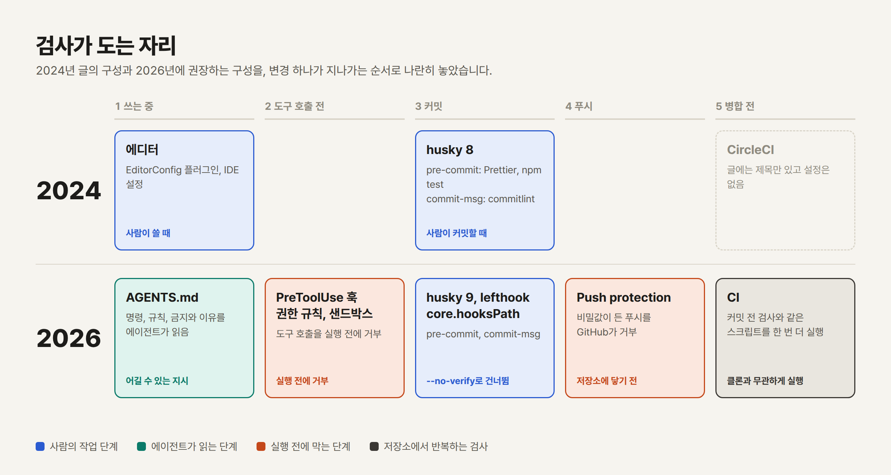
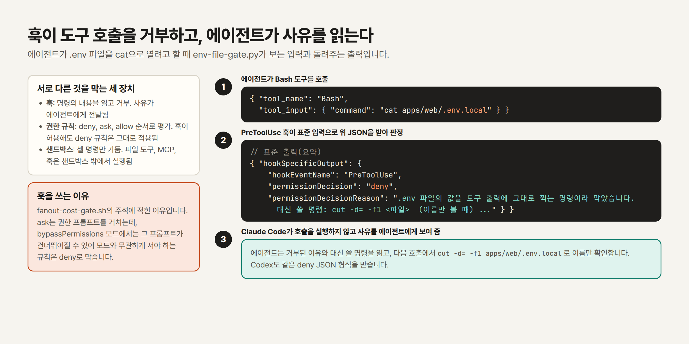
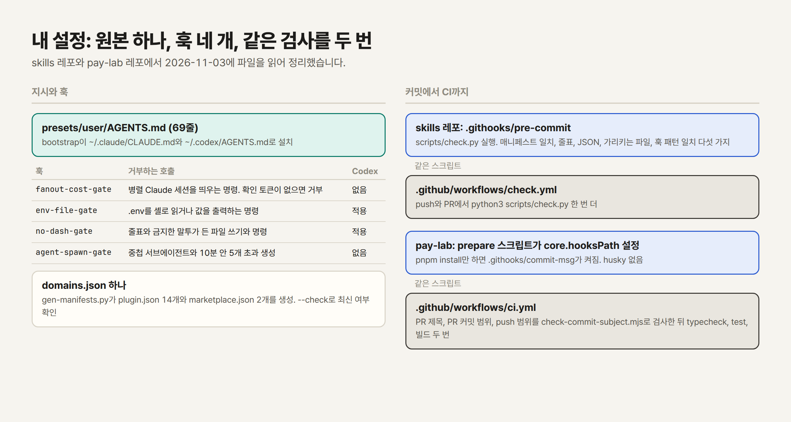

안녕하세요. <strong>Kyle</strong>입니다.

2024년 9월에 [프로젝트 초기 개발 환경 설정 권장 사례](/blog/archive/project-initial-setup)를 썼습니다. EditorConfig, Prettier, ESLint, commitlint, husky로 팀의 규칙을 도구에 옮기는 글이었습니다. 2년이 지나 그 글의 도구 목록에서 버전이 바뀐 것이 많고, 코드를 쓰는 주체에 코딩 에이전트가 들어왔습니다. 같은 주제를 2026년 기준으로 다시 썼습니다.

---

## 0. TL;DR

**첫째, 2024년 글의 뼈대는 남지만 규칙을 읽는 대상이 달라졌습니다.** 사람 동료에게 하던 약속을 AGENTS.md로 적고, 어기면 안 되는 것은 에이전트 훅과 권한 규칙으로 실행 전에 막습니다.

**둘째, 검사가 여러 겹으로 돕니다.** 에이전트 훅, 커밋 전 git 훅, 푸시 보호, CI가 각자 다른 것을 막고, CI는 커밋 전 검사와 같은 스크립트를 한 번 더 실행합니다.

**셋째, 도구는 빠르고 고정할 수 있는 방향으로 옮겨 갔습니다.** ESLint는 flat config만 남았고, Biome, Oxlint, Ruff 같은 Rust 도구가 있으며, Node와 패키지 매니저 버전은 파일 하나에 고정합니다.

---

## 1. 2024년 글에서 버전이 바뀐 도구들

2024년 글의 예시를 2026-11-03에 각 도구의 공식 문서와 npm 레지스트리에서 다시 확인했습니다. 가운데 열은 글과 common-config 레포(`kyle-park-io/common-config`, 지금은 비공개)에 적은 선택이고, 오른쪽 열은 확인한 현재 상태입니다.

| 도구 | 2024년 글과 레포 | 2026-11-03 확인한 상태 |
| --- | --- | --- |
| ESLint | `.eslintrc.js` 설정, 레포 템플릿은 8.x | v9.0.0(2024-04)에서 [flat config가 기본이 되고 eslintrc는 deprecated](https://eslint.org/blog/2024/04/eslint-v9.0.0-released/), v10.0.0에서 [eslintrc 설정 체계가 제거됨](https://eslint.org/blog/2026/02/eslint-v10.0.0-released/). 최신은 10.14.0(2026-10-30) |
| husky | 8.x와 `pinst`, 훅 파일 첫 줄에 `husky.sh` 호출 | 최신 9.1.7(2024-11-18). `husky init`이 `.husky/pre-commit`을 만들고 `prepare` 스크립트를 고침. [get-started 문서](https://typicode.github.io/husky/get-started.html)의 예시 훅은 명령만 적은 파일 |
| commitlint | 18.x | 최신 21.2.4(2026-10-18) |
| Prettier | 3.x | 3.9.10(2026-10-10)까지 이어지는 배포. 같은 일을 하는 대안은 [Biome](https://biomejs.dev/installation/quick-start/)과 [Oxfmt](https://oxc.rs/docs/guide/usage/formatter.html) |
| 패키지 매니저 | yarn 1.22.22 | pnpm 12.16.1(2026-10-27). Node 25부터 Node 배포본에서 빠진 Corepack |
| Node | 글이 나온 때의 LTS는 v20 | 2026-04-30에 지원이 끝난 v20. 2026-10-28에 Active LTS가 된 v26, 2026-10-20부터 유지보수 단계인 v24 |

출처: [ESLint 설정 문서](https://eslint.org/docs/latest/use/configure/configuration-files), [Node.js 릴리스 일정](https://raw.githubusercontent.com/nodejs/Release/main/schedule.json), 버전과 날짜는 npm 레지스트리 JSON([eslint](https://registry.npmjs.org/eslint), [husky](https://registry.npmjs.org/husky), [@commitlint/cli](https://registry.npmjs.org/@commitlint/cli), [prettier](https://registry.npmjs.org/prettier), [pnpm](https://registry.npmjs.org/pnpm))에서 읽었습니다.

2024년 글의 ESLint 예시(`extends: ['standard-with-typescript', ...]`을 담은 `.eslintrc.js`)는 지금 ESLint 10에서 그대로 쓸 수 없습니다. 스타일을 정하는 EditorConfig와 Conventional Commits라는 커밋 규칙은 그대로 유효하다고 봅니다. 도구 이름이 달라졌을 뿐 규칙의 내용은 바뀌지 않았습니다.



그림 1은 변경 하나가 쓰는 중에서 병합 전까지 지나가는 단계를 2024년과 2026년으로 나란히 그렸습니다. 2024년에는 사람이 에디터와 커밋 단계를 거쳤고, 2026년에는 에이전트가 읽는 지시와 실행 전 거부, 푸시 보호가 앞뒤에 붙었습니다.

---

## 2. 코드를 쓰는 주체에 에이전트가 들어왔다는 조사 수치

"요즘은 AI가 코드를 쓴다"는 말의 근거를 조사 세 건의 수치로 확인했습니다. 아래 표는 각 조사 페이지의 문장을 옮긴 것입니다.

| 조사 | 수치 | 함께 적힌 수치 |
| --- | --- | --- |
| [Stack Overflow Developer Survey 2025](https://survey.stackoverflow.co/2025/ai) | 응답자의 84%가 개발 과정에 AI 도구를 쓰는 중이거나 쓸 계획(전년 76%) | 전문 개발자의 51%가 매일 사용 |
| [JetBrains State of Developer Ecosystem 2025](https://blog.jetbrains.com/research/2025/10/state-of-developer-ecosystem-2025/) | 개발자의 85%가 코딩과 개발에 AI 도구를 정기적으로 사용, 62%가 AI 코딩 어시스턴트, 에이전트, 코드 에디터 가운데 하나 이상에 의존 | 194개국 개발자 24,534명 응답 |
| [GitHub Octoverse 2025](https://github.blog/news-insights/octoverse/octoverse-a-new-developer-joins-github-every-second-as-ai-leads-typescript-to-1/) | 신규 개발자의 80%가 첫 주에 Copilot 사용 | 2025년 8월에 GitHub 최다 사용 언어가 된 TypeScript |

Octoverse는 TypeScript가 올라온 이유를 "에이전트를 쓰는 코딩을 운영에서 더 믿을 수 있게 만드는 타입 언어로의 이동"이라고 설명합니다. 린터와 타입 검사가 에이전트의 실수를 잡는 장치로도 쓰인다는 뜻으로 읽었습니다.

수치가 한 방향으로만 읽히지는 않습니다. Stack Overflow 조사에서 AI 도구의 정확도를 믿지 않는다는 응답이 46%, 믿는다는 응답이 33%였고, 에이전트에 대해서는 "아직 주류가 아니다. 개발자의 52%는 에이전트를 쓰지 않거나 더 단순한 AI 도구에 머물고, 38%는 도입할 계획이 없다"고 적었습니다. 도구는 널리 쓰이지만 믿고 맡기는 단계는 아니라는 수치입니다. 저는 이 간격이 새 레포의 설정에서 가장 크게 달라진 이유라고 봅니다. 맡기되 틀렸을 때 잡는 장치를 먼저 깔아 두는 설정이 늘었습니다.

---

## 3. 규칙의 첫 독자가 에이전트가 된 AGENTS.md

2024년 글은 규칙을 사람이 어겨도 도구가 잡도록 만드는 데 집중했습니다. 2026년에는 규칙을 먼저 읽는 것이 에이전트인 경우가 많아서, 읽을 파일이 따로 생겼습니다.

[agents.md](https://agents.md/)는 코딩 에이전트에게 지침을 주는 열린 형식이라고 소개하며 "60k개가 넘는 오픈소스 프로젝트에서 쓰인다"고 적습니다. 2025-12-09 [Linux Foundation 발표](https://www.linuxfoundation.org/press/linux-foundation-announces-the-formation-of-the-agentic-ai-foundation)에는 6만 개가 넘는 오픈소스 프로젝트와 에이전트 프레임워크가 채택했고 Codex, Cursor, GitHub Copilot, VS Code가 포함된다고 나옵니다. 이 형식은 지금 Agentic AI Foundation이 관리합니다.

도구마다 읽는 방식은 문서에 이렇게 적혀 있습니다.

- **Claude Code**: [메모리 문서](https://code.claude.com/docs/en/memory)에 따르면 `AGENTS.md`만 있으면 그것을 읽고, `CLAUDE.md`도 같이 있으면 `CLAUDE.md`만 읽습니다. `CLAUDE.md`에 `@AGENTS.md`를 적으면 import됩니다. `AGENTS.md`를 직접 읽으려면 Claude Code v2.1.277 이상이어야 합니다. `CLAUDE.md` 한 파일은 200줄 아래를 목표로 하라고 권합니다.
- **Codex**: [AGENTS.md 가이드](https://learn.chatgpt.com/docs/agent-configuration/agents-md)에 따르면 `AGENTS.md`를 읽고, 합친 크기는 `project_doc_max_bytes`(기본 32 KiB)에서 멈춥니다.
- **GitHub Copilot**: [레포 지침 문서](https://docs.github.com/en/copilot/how-tos/copilot-on-github/customize-copilot/add-custom-instructions/add-repository-instructions)에 따르면 레포 안 어디에든 `AGENTS.md`를 둘 수 있고 가장 가까운 파일이 우선합니다.
- **Cursor**: [Rules 문서](https://cursor.com/docs/rules)가 `AGENTS.md`를 `.cursor/rules`의 단순한 대안으로 설명합니다.

그래서 새 레포에는 `AGENTS.md` 하나를 쓰고 `CLAUDE.md`에는 `@AGENTS.md` 한 줄만 두는 구성이 안전하다고 판단합니다. 구버전 Claude Code를 쓰는 동료가 있어도 같은 내용을 읽습니다. 제 pay-lab 레포의 `CLAUDE.md`가 이 한 줄입니다.

`AGENTS.md`에 들어갈 것은 EditorConfig와 다릅니다. 들여쓰기 같은 형식 대신 에이전트가 모르는 것을 적습니다. 확인 명령, 지켜야 할 규칙, 건드리면 안 되는 것과 그 이유입니다.

```md
# AGENTS.md  (2026-11-03 기준 예시)

## 확인
pnpm typecheck && pnpm test   # 커밋마다. CI도 같은 명령을 실행한다

## 규칙
- 커밋 제목은 영어 Conventional Commits다. `<type>(<scope>): <subject>`
- 새 환경 변수는 같은 커밋에서 `.env.example`에 이름만 적는다

## 하지 않는 것
- `.env` 값을 읽거나 출력하지 않는다. 이름은 `.env.example`에 있다
- 생성 파일(`plugin.json`)은 고치지 않는다. 원본(`domains.json`)을 고치고 생성기를 돌린다
```

pay-lab의 `AGENTS.md`는 규칙마다 그 규칙이 생긴 사건을 적습니다. 예를 들어 잔고를 못 읽으면 보내지 않는다는 규칙에는 8월 행사에서 돈이 더 나간 두 건의 커밋이 붙어 있습니다. 이유가 적혀 있으면 에이전트가 규칙의 경계를 판단할 때 근거가 생긴다고 봅니다.

다만 `AGENTS.md`는 지시입니다. 에이전트는 읽고도 어길 수 있습니다. 어기면 안 되는 규칙은 다음 절의 장치로 옮깁니다.

---

## 4. 지시는 어길 수 있으니 훅과 권한이 맡는 거부

husky의 `pre-commit`은 사람이 `git commit`을 실행할 때 돕니다. 에이전트는 그 앞 단계에서 파일을 쓰고 셸 명령을 실행하므로, 그 호출 자체를 막는 단계가 필요합니다.

[Claude Code 훅 문서](https://code.claude.com/docs/en/hooks)는 `PreToolUse`를 "도구 호출이 실행되기 전. 막을 수 있다"고 설명합니다. 훅이 `permissionDecision: "deny"`를 담은 JSON을 출력하면 호출은 실행되지 않고, 사유는 Claude에게 보입니다. [Codex 훅 문서](https://learn.chatgpt.com/docs/hooks)도 같은 deny 형식과 종료 코드 2를 받습니다. 두 문서가 같은 형식을 쓰기 때문에 제 훅 스크립트 하나를 두 도구에 같이 설치할 수 있었습니다.



그림 2는 에이전트가 `.env.local`을 `cat`으로 열려 할 때 훅이 받는 입력과 돌려주는 출력입니다. 사유 문장에 대신 쓸 명령을 넣은 것이 요점입니다. 사유를 읽는 것은 에이전트이므로, 거부만 하면 우회를 시도하고 대안을 알려 주면 그 명령으로 다시 시도합니다.

권한 규칙과 샌드박스는 훅과 다른 것을 막습니다.

- [권한 문서](https://code.claude.com/docs/en/permissions)는 규칙을 deny, ask, allow 순서로 평가하고, PreToolUse 훅이 허용해도 deny와 ask 규칙은 그대로 적용된다고 적습니다. `Read(./.env)`처럼 파일을 지정하는 규칙이 이 문서의 예시입니다.
- [샌드박스 문서](https://code.claude.com/docs/en/sandboxing)는 샌드박스가 셸 명령만 가둔다고 적습니다. 파일 도구, MCP 서버, 훅은 샌드박스 밖에서 실행됩니다. Codex의 [보안 문서](https://learn.chatgpt.com/docs/agent-approvals-security)는 `--sandbox workspace-write --ask-for-approval on-request` 조합을 예로 들고, 이 모드에서는 네트워크가 기본으로 꺼져 있다고 적습니다.

그래서 파일을 읽는 도구까지 막는 것은 권한 규칙입니다. 프로젝트의 `.claude/settings.json`에 적는 최소 예시입니다.

```json
{
  "permissions": {
    "deny": ["Read(./.env)", "Bash(git push *)"]
  }
}
```

두 규칙 모두 권한 문서의 예시에서 가져왔습니다(2026-11-03 확인).

스킬도 같은 흐름에 있습니다. [Claude Code 문서](https://code.claude.com/docs/en/skills)는 스킬이 [Agent Skills](https://agentskills.io/home) 열린 표준을 따르고 여러 AI 도구에서 쓸 수 있다고 적습니다. 반복해서 붙여 넣던 절차를 `SKILL.md`로 옮겨 두는 것이 2024년의 "팀 위키"에 해당한다고 봅니다.

---

## 5. 가벼워진 git 훅과 같은 검사를 반복하는 CI

2024년 글의 `husky install`과 `pinst`는 husky 9에서 필요하지 않습니다. husky 사이트는 husky를 gzip으로 2 kB, 의존성 없음으로 소개하고 git의 `core.hooksPath`를 쓴다고 적습니다. `npx husky init` 한 번으로 `.husky/pre-commit`과 `prepare` 스크립트가 생기고, 훅 파일은 셸 명령만 적습니다.

```sh
# .husky/pre-commit  (husky 9 문서의 예시 형식, 2026-11-03 확인)
pnpm typecheck && pnpm test
```

대안으로 [lefthook](https://lefthook.dev/)은 `lefthook.yml` 설정 파일로 훅을 적고 `parallel`로 명령을 병렬 실행합니다. [pre-commit](https://pre-commit.com/)은 여러 언어의 훅을 관리하는 프레임워크로, Python 레포에서 많이 쓰입니다. 아래는 lefthook 문서의 예시 형식에 맞춘 설정입니다.

```yaml
# lefthook.yml  (lefthook 문서의 예시 형식, 2026-11-03 확인)
pre-commit:
  parallel: true
  jobs:
    - run: pnpm biome check --write {staged_files}
      glob: ["*.ts", "*.tsx", "*.json"]
      stage_fixed: true
```

도구는 취향이고 중요한 것은 CI입니다. git 훅은 `--no-verify`로 건너뛸 수 있고, 훅을 켜지 않은 클론에서는 돌지 않습니다. 제 skills 레포의 `AGENTS.md`에 이 이유가 적혀 있습니다. 2026-09-21에 커밋 세 개가 생성물인 `plugin.json`의 버전만 손으로 올려 원본과 어긋난 채 main에 쌓였고, 확인 명령은 문서에 적혀 있었지만 돌린 사람이 없었습니다. 그 뒤 같은 스크립트를 pre-commit 훅과 CI에서 둘 다 실행합니다.

커밋 제목은 commitlint 외에 스크립트로도 검사할 수 있습니다. pay-lab은 husky 대신 `package.json`의 `prepare`에서 `git config core.hooksPath .githooks`를 실행하고, 제목 정규식은 92줄짜리 `check-commit-subject.mjs`에 둡니다. 이 스크립트는 실행할 때마다 정규식 자체를 11개 샘플로 먼저 검사해서, 정규식이 깨져 전부 통과시키는 일을 막습니다.

---

## 6. 포매터와 린터, 런타임 고정의 2026년 선택지

도구를 고르는 기준은 두 가지입니다. 에이전트가 파일을 수십 개 고친 뒤에도 몇 초 안에 도는지, 그리고 모든 클론과 CI에서 같은 버전이 도는지입니다. 아래는 공식 문서의 문장과 버전입니다.

| 영역 | 2026-11-03 확인한 선택지 | 근거 |
| --- | --- | --- |
| JS와 TS 포매터와 린터 | [Biome](https://biomejs.dev/) 2.6.4(2026-10-28): "Format, lint, and more in a fraction of a second" | `biome check`가 포매터, 린터, assist 동작을 한 번에 실행 |
| JS와 TS 린터 | [Oxlint](https://oxc.rs/docs/guide/usage/linter.html) 1.90.0: 자체 벤치마크에서 ESLint보다 50배에서 100배 빠름 | Oxc 프로젝트가 낸 수치 |
| 기존 구성 유지 | ESLint 10(flat config)과 Prettier 3 | 설정 객체 배열을 내보내는 `eslint.config.js` |
| Python | [Ruff](https://docs.astral.sh/ruff/) 0.17.3: Flake8, Black보다 10배에서 100배 빠름. [uv](https://docs.astral.sh/uv/) 0.13.6: pip, poetry, pyenv 등을 대체하는 도구 하나 | 각 프로젝트 문서의 문구. 버전은 GitHub 릴리스 |

속도 수치는 모두 각 프로젝트가 낸 값입니다. Biome를 쓸 때 설정 파일은 `biome init`이 만듭니다.

```json
{
  "$schema": "https://biomejs.dev/schemas/2.6.4/schema.json",
  "formatter": { "enabled": true, "indentStyle": "space", "indentWidth": 2 },
  "linter": { "enabled": true }
}
```

생성 파일의 형식에 2024년 글의 EditorConfig 값(공백 2칸)을 옮긴 예시입니다. 설치할 때는 `-E` 플래그로 정확한 버전을 package.json에 고정하라고 [Biome 빠른 시작 문서](https://biomejs.dev/installation/quick-start/)가 권합니다. 모든 기여자와 CI가 같은 버전을 쓰게 하기 위해서입니다.

저는 새 레포에서는 한 벌짜리 도구를 먼저 검토하고, 커스텀 규칙과 플러그인이 필요하면 ESLint 10을 고릅니다.

런타임 고정은 파일 하나로 합니다. [mise](https://mise.jdx.dev/getting-started.html)는 프로젝트의 도구, 환경 변수, 작업을 `mise.toml` 하나에 적고 셸, 에디터, CI에서 같게 쓴다고 소개합니다(최신 v2026.10.25).

```toml
# mise.toml  (README 예시 형식, 2026-11-03 확인)
[tools]
node = "24"
```

패키지 매니저는 `package.json`의 `packageManager`에 고정합니다.

```json
{ "packageManager": "pnpm@12.16.1" }
```

pay-lab의 CI는 `pnpm/action-setup`이 이 필드에서 pnpm 버전을 읽게 하고, `pnpm install --frozen-lockfile`로 설치합니다.

cf. Corepack은 [README](https://raw.githubusercontent.com/nodejs/corepack/main/README.md)에 14.19.0부터 25.0.0 미만 Node에 포함되어 배포된다고 적혀 있고, Node 25 [변경 내역](https://raw.githubusercontent.com/nodejs/node/main/doc/changelogs/CHANGELOG_V25.md)에 "stop distributing Corepack"이 있습니다. 2024년 글 시절에 `corepack enable`로 yarn과 pnpm을 쓰던 구성은 이제 `npm install -g corepack`으로 설치하거나 mise로 옮겨야 합니다.

---

## 7. 비밀값과 의존성 갱신의 자동화

에이전트는 파일을 많이 읽고 명령을 많이 실행합니다. `.env`가 대화 기록에 남을 위험도 같이 커졌다고 봅니다. 제 `env-file-gate` 훅이 생긴 계기도 그것이었습니다.

- **푸시 보호**: GitHub 문서는 push protection이 "비밀값이 든 푸시를 저장소에 닿기 전에 막는다"고 설명합니다. 막힌 푸시는 비밀값을 지우고 다시 푸시해야 합니다. 저장소 설정에서 켜는 기능이라 코드 변경이 필요 없습니다. [문서](https://docs.github.com/en/code-security/concepts/secret-security/push-protection)
- **로컬 스캔**: [Gitleaks](https://github.com/gitleaks/gitleaks)는 pre-commit 훅이나 GitHub Action으로 쓸 수 있습니다. 새 기능 개발은 멈췄습니다(아래 cf.).
- **의존성 갱신**: GitHub의 [Dependabot version updates](https://docs.github.com/en/code-security/concepts/supply-chain-security/dependabot-version-updates)는 취약점이 없어도 의존성을 최신으로 유지하는 PR을 만듭니다. [Renovate](https://docs.renovatebot.com/)는 PR을 만드는 시간을 일정으로 정해 소음을 줄이는 기능을 내세웁니다.

cf. Gitleaks README는 "Gitleaks는 기능이 완성되었다. 새 기능을 병합하지 않으며 앞으로의 릴리스는 보안 패치뿐이다. Betterleaks에 집중하겠다"고 적습니다. 마지막 릴리스는 v8.30.1(2026-03-21)입니다. 새로 고른다면 push protection을 기본으로 두고, 스캐너는 이 상태를 알고 고르는 편이 좋다고 봅니다.

cf. 개발 환경 자체를 파일로 두는 [Dev Containers](https://containers.dev/)는 홈페이지에서 "개발에 필요한 내용과 설정으로 컨테이너를 채우는 열린 명세"라고 소개합니다.

---

## 8. 내 설정 한 사례: 원본 하나와 훅 네 개

제가 쓰는 설정을 `skills`, `pay-lab`, `blog` 세 레포의 파일 기준으로 정리했습니다. `skills`와 `pay-lab`은 비공개 레포라 링크 대신 파일 이름을 적습니다.



그림 3의 왼쪽 열은 지시와 훅, 오른쪽 열은 커밋에서 CI까지입니다.

**전역 지시는 원본 하나입니다.** `skills` 레포의 `presets/user/AGENTS.md`(69줄)가 원본이고, 부트스트랩 스크립트가 `~/.claude/CLAUDE.md`와 `~/.codex/AGENTS.md`로 설치합니다. 두 도구가 같은 글을 읽습니다.

**훅은 네 개이고, 모두 사건에서 나왔습니다.** 각 스크립트 첫머리의 주석에 이유가 적혀 있습니다.

- `fanout-cost-gate`: 병렬 Claude 세션을 띄우는 명령을 세션 수와 함께 거부하고, 명령 앞에 `CLAUDE_FANOUT_ACK=<세션 수>`를 붙이면 통과시킵니다. 2026-09-09에 트리거 평가를 쿼리 14개, 3회씩 돌리는 명령 하나가 Opus 세션 42개를 띄운 일이 계기였습니다.
- `env-file-gate`: `.env`를 `source`로 읽거나 `cat`으로 출력하는 명령을 거부합니다. 2026-10-22에 `.env.local`을 셸로 읽다가 URL의 `&`가 백그라운드 실행으로 해석되어 비밀값이 든 줄이 도구 출력에 찍힌 일이 계기였습니다.
- `no-dash-gate`: 줄표와 글쓰기 지침에서 금지한 말투가 든 파일 쓰기와 명령을 거부합니다. 패턴은 `writing-guides`의 `check.py`와 같고, `check.py --parity`가 두 파일의 패턴이 같은지 비교합니다.
- `agent-spawn-gate`: 서브에이전트 안에서 서브에이전트를 부르는 호출, fork, 10분 안에 5개를 넘는 생성을 거부합니다. 2026-09-21에 조사 에이전트 4개가 하위 에이전트 17개를 더 띄워 3분 안에 Opus 에이전트 21개가 돈 일이 계기였습니다.

Codex에는 `no-dash-gate`와 `env-file-gate`만 설치합니다. 나머지 둘은 Claude 세션 수를 세는 훅이라 Codex에는 적용되지 않고, skills 레포 `AGENTS.md`에는 Codex에서 같은 계산을 실행하는 사람이 먼저 확인하라고 적혀 있습니다.

제 사용자 설정(`~/.claude/settings.json`)에는 `permissions`와 `sandbox` 키가 없고 `hooks`가 있습니다. 훅을 deny로 쓰는 이유는 `fanout-cost-gate.sh` 주석에 적혀 있습니다. ask는 권한 프롬프트를 거치는데 `bypassPermissions` 모드에서 그 프롬프트가 건너뛰어질 수 있어서, 모드와 무관하게 서야 하는 규칙은 deny로 막습니다.

**하나의 원본에서 두 도구의 파일을 생성합니다.** `domains.json`을 고치고 `gen-manifests.py`를 돌리면 Claude Code와 Codex용 `plugin.json` 14개와 `marketplace.json` 2개가 생기고, `--check`가 생성물이 최신인지 확인합니다. 스킬 본문에는 도구 이름(`Read` 툴, `Task` 호출)을 쓰지 않고 "파일을 읽는다"처럼 동작으로 적는 규칙이 있어서, 같은 스킬 파일이 두 도구에서 그대로 돕니다.

**검사 스크립트를 훅과 CI가 같이 부릅니다.** skills 레포는 `.githooks/pre-commit`이 `scripts/check.py`를 실행하고, `.github/workflows/check.yml`이 push와 PR에서 같은 스크립트를 한 번 더 실행합니다. pay-lab은 `commit-msg` 훅이 제목을 검사하고, `ci.yml`이 PR 제목과 PR 커밋 범위, push 범위를 같은 스크립트로 검사한 뒤 `typecheck`, `test`, 회차 설정이 다른 빌드 두 번을 실행합니다.

**아직 2024년 방식인 레포도 있습니다.** 이 블로그 레포는 husky 8.0.3, commitlint 18.4.2, yarn 1.22.22를 그대로 씁니다. `.husky/pre-commit`이 `yarn run validate`와 `yarn run typecheck`를 실행하고 `commit-msg`가 commitlint를 실행합니다. 지금 구성으로 검사가 돌고 있어 옮기지 않았습니다. 이 레포에는 `AGENTS.md`가 없고 글 쓰는 규칙은 `CONTRIBUTING.md`에 있습니다. 새 레포부터 아래 체크리스트를 적용하고, 기존 레포는 손댈 이유가 생길 때 옮길 계획입니다.

---

## 9. 새 레포 시작 체크리스트

위 내용을 새 레포에서 하는 순서로 모았습니다. 앞 번호일수록 나중에 고치기 어렵습니다.

1. **버전을 고정합니다.** `mise.toml`에 Node LTS를, `package.json`의 `packageManager`에 패키지 매니저를 적습니다. 2026-11-03 기준 Active LTS는 v26이고, v24는 유지보수 단계 LTS입니다.
2. **`.editorconfig`를 둡니다.** 2024년 글의 값(들여쓰기, 줄바꿈 LF, UTF-8, 끝 공백 제거)을 그대로 씁니다.
3. **포매터와 린터를 한 벌 고릅니다.** Biome, 또는 ESLint 10과 Prettier 3입니다. Python이면 Ruff입니다. 버전은 정확히 고정합니다.
4. **커밋 제목 규칙을 정합니다.** Conventional Commits를 쓰고, commitlint나 짧은 스크립트로 검사합니다.
5. **검사를 스크립트 하나로 모읍니다.** `pnpm typecheck && pnpm test`처럼 한 명령으로 만들어 훅과 CI가 같은 것을 부르게 합니다.
6. **git 훅을 켭니다.** husky 9, lefthook, `core.hooksPath` 가운데 하나를 쓰고, `prepare` 스크립트로 `pnpm install`이 훅을 켜게 합니다.
7. **CI에서 같은 스크립트를 실행합니다.** `--frozen-lockfile`로 설치하고, 빌드도 한 번 실행합니다. 훅을 건너뛴 커밋이 여기서 걸립니다.
8. **`AGENTS.md`를 씁니다.** 확인 명령, 규칙, 하지 않는 것과 그 이유를 적고, `CLAUDE.md`에는 `@AGENTS.md` 한 줄을 둡니다. 200줄 안에 들게 합니다.
9. **에이전트 가드를 하나부터 둡니다.** `permissions.deny`에 `Read(./.env)` 같은 규칙을 넣고, 규칙으로 표현하기 어려운 것은 PreToolUse 훅으로 만듭니다. 거부 사유에는 대신 쓸 명령을 적습니다.
10. **비밀값을 막습니다.** push protection을 켜고, `.env.example`에는 이름만 적습니다.
11. **의존성 갱신 PR을 자동으로 받습니다.** Dependabot이나 Renovate 중 하나를 설정합니다.
12. **환경 차이로 문제가 생기면 Dev Container를 추가합니다.** 처음부터 둘 필요는 없다고 판단합니다.

---

## 정리

**① 2024년 글의 도구 목록은 버전이 바뀐 항목이 많습니다.** ESLint는 flat config만 남았고, husky는 9에서 단순해졌으며, Node 20은 지원이 끝났습니다.

**② 코드를 쓰는 주체에 에이전트가 들어왔지만 아직 믿고 맡기는 단계는 아닙니다.** AI 도구 사용 비율은 조사마다 84%와 85%이고, 에이전트를 쓰지 않거나 도입 계획이 없다는 응답이 Stack Overflow 조사에서 과반입니다.

**③ 규칙은 먼저 AGENTS.md에 적습니다.** 여러 도구가 읽는 열린 형식이고, 이유와 확인 명령까지 적어야 쓸모가 있습니다.

**④ 어기면 안 되는 규칙은 훅과 권한이 실행 전에 막습니다.** 거부 사유는 에이전트가 읽으므로 대신 쓸 명령을 담습니다.

**⑤ 같은 검사를 훅과 CI에서 두 번 실행합니다.** 훅은 건너뛸 수 있고 CI는 클론과 무관하게 돕니다.

**⑥ 도구는 빠르고 고정할 수 있는 것으로 고릅니다.** 버전은 `mise.toml`, `packageManager`, 정확한 의존성 버전으로 못 박습니다.

---

## 측정 기준과 출처

- **확인 시각**: 문서와 레지스트리는 모두 2026-11-03(KST) 새벽에 원문을 받아 읽었습니다. 버전과 배포일은 그 시각의 최신입니다.
- **조사 수치**: [Stack Overflow Developer Survey 2025](https://survey.stackoverflow.co/2025/ai)(게시일은 페이지에 없어 확인하지 못함), [JetBrains State of Developer Ecosystem 2025](https://blog.jetbrains.com/research/2025/10/state-of-developer-ecosystem-2025/), [GitHub Octoverse 2025](https://github.blog/news-insights/octoverse/octoverse-a-new-developer-joins-github-every-second-as-ai-leads-typescript-to-1/)(2025-10-28, 2026-02-28 갱신)
- **에이전트 지침**: [agents.md](https://agents.md/), [Linux Foundation 발표](https://www.linuxfoundation.org/press/linux-foundation-announces-the-formation-of-the-agentic-ai-foundation)(2025-12-09), [Claude Code 메모리](https://code.claude.com/docs/en/memory), [Codex AGENTS.md](https://learn.chatgpt.com/docs/agent-configuration/agents-md), [Copilot 레포 지침](https://docs.github.com/en/copilot/how-tos/copilot-on-github/customize-copilot/add-custom-instructions/add-repository-instructions), [Cursor Rules](https://cursor.com/docs/rules)
- **훅, 권한, 샌드박스, 스킬**: [Claude Code 훅](https://code.claude.com/docs/en/hooks), [권한](https://code.claude.com/docs/en/permissions), [샌드박스](https://code.claude.com/docs/en/sandboxing), [스킬](https://code.claude.com/docs/en/skills), [Codex 훅](https://learn.chatgpt.com/docs/hooks), [Codex 보안](https://learn.chatgpt.com/docs/agent-approvals-security), [Agent Skills 명세](https://agentskills.io/specification)
- **포매터, 린터, 런타임**: [ESLint 설정](https://eslint.org/docs/latest/use/configure/configuration-files), [Biome](https://biomejs.dev/), [Oxlint](https://oxc.rs/docs/guide/usage/linter.html), [Ruff](https://docs.astral.sh/ruff/), [uv](https://docs.astral.sh/uv/), [mise](https://mise.jdx.dev/), [Node.js 릴리스 일정](https://raw.githubusercontent.com/nodejs/Release/main/schedule.json), [Corepack](https://raw.githubusercontent.com/nodejs/corepack/main/README.md)
- **git 훅과 커밋**: [husky](https://typicode.github.io/husky/get-started.html), [lefthook](https://lefthook.dev/), [pre-commit](https://pre-commit.com/), [Conventional Commits](https://www.conventionalcommits.org/en/v1.0.0/), [commitlint](https://commitlint.js.org/)
- **비밀값, 의존성, 환경**: [push protection](https://docs.github.com/en/code-security/concepts/secret-security/push-protection), [Gitleaks](https://github.com/gitleaks/gitleaks), [Dependabot](https://docs.github.com/en/code-security/concepts/supply-chain-security/dependabot-version-updates), [Renovate](https://docs.renovatebot.com/), [Dev Containers](https://containers.dev/)
- **직접 읽은 파일(2026-11-03)**: skills 레포의 `AGENTS.md`, `presets/user/AGENTS.md`, `presets/user/hooks/`, `.githooks/pre-commit`, `.github/workflows/check.yml`, `scripts/check.py`. pay-lab 레포의 `AGENTS.md`, `package.json`, `.githooks/commit-msg`, `scripts/check-commit-subject.mjs`, `.github/workflows/ci.yml`. blog 레포의 `package.json`, `.husky/`
- **버전을 읽은 위치**: npm 패키지는 npm 레지스트리, Ruff와 uv는 GitHub 릴리스. 속도 수치는 각 프로젝트가 낸 값이고 다시 재지 않았습니다
- **확인하지 못한 것**: Copilot과 Cursor의 훅, Octoverse의 에이전트 전용 수치, ESLint와 Prettier 조합의 사용 비율, Biome와 Prettier의 호환 정도, Oxfmt의 안정성, Node 26의 Corepack 동작, Dependabot과 Renovate의 비교 측정, Codespaces의 세부 설정, 내 프로젝트와 관리형 Claude 설정

---

빠진 도구나 다르게 쓰시는 조합이 있으시면 댓글로 알려 주십시오.

Kyle
